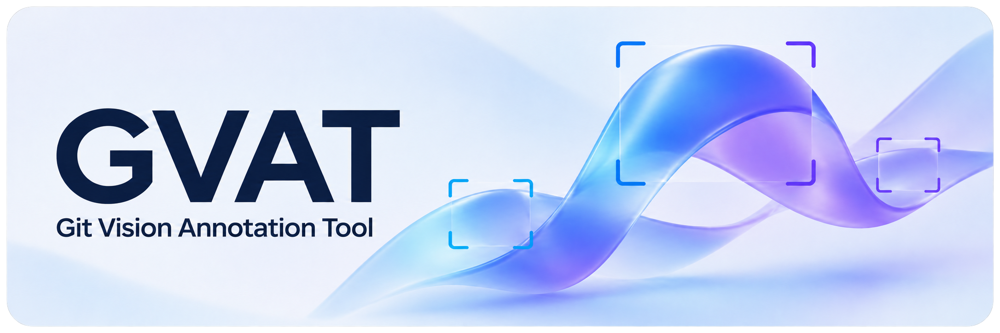

**GVAT (Git Vision Annotation Tool)** is a fork of
[CVAT](https://github.com/cvat-ai/cvat) for labeling and reviewing images and videos
directly in a local Git checkout. Save annotations to CVAT XML and use your
repository's merge request workflow to review the changes and share feedback.
GVAT runs locally against your files, so there is no shared CVAT server to maintain.
The command opens CVAT's own annotation page, including its native labeling and
review workspaces.

## Install and uninstall

Install from a Linux Bash terminal in this checkout:

```bash
./install.sh
source ~/.bashrc
```

The installer builds GVAT and adds a `gvat` Bash alias to `~/.bashrc`.
Python 3.10+ with `venv` and development headers is required. Node, FFmpeg and
exporter build tools are installed locally when needed. Setup runs as your user
without `sudo` or system package installation.
Detailed output is saved to `.gvat-cache/install.log`.

Setup tries `python3`, then `python`, and checks the version. To choose an
interpreter explicitly, use its executable path:

```bash
GVAT_PYTHON=/path/to/python ./install.sh
```

The same override works with `./uninstall.sh`. Shell aliases are not reliably
available inside scripts; an executable path avoids that dependency.

The first install copies the root [config.yml](config.yml) to
`~/.config/gvat/config.yml` (or `$XDG_CONFIG_HOME/gvat/config.yml`). Later installs
preserve your settings. Edit that file to set your defaults:

```yaml
import:
  xml_version: auto
media:
  preferred_type: images
player:
  step: 10
  pixelated: false
export:
  dataset_format: auto
  labels_format: auto
buffer:
  seconds: 15
  max_memory: null
```

Set `pixelated: true` for sharp pixels, or use a format name such as
`labels_format: "YOLO 1.1"`. `auto` selects the matching CVAT XML format.
`max_memory: "4GiB"` sets a smaller memory limit; `null` uses the automatic RAM
cap. Restart GVAT after changing the file. `--config="./config.yml"` selects a
different config, and `GVAT_CONFIG` can select its path for installation and use.
CLI flags such as `--xml-version=1.0`, `--step=5`, `--pixelated`, `--smooth-images`,
`--buffer-seconds=30`, and `--buffer-memory=4GiB` override the file.

`media.preferred_type` chooses `images`, `video`, or `all` in folders containing
both images and video. The default prefers images, falling back to video if
there are no images. Set it to `video` to reverse that preference, or use
`--media-type=video` for one command. `all` combines both types. Existing XML
selects its matching media so a changed preference does not reinterpret saved
annotations; choose another XML with `--annotations` to start a different task.

To uninstall:

```bash
./uninstall.sh
```

This removes the alias, installed command, local environment, and editor build.
Source code, media, XML, reviews, your config, and the shared label list are preserved. Open a new Bash
terminal afterward, or run `unalias gvat`. Details go to `.gvat-cache/uninstall.log`.

## Annotate and review

An annotation folder contains source images or video and a CVAT XML file.
GVAT reads and saves annotations directly in that XML. A shared `labels.txt`
contains one class name per line and initializes class definitions for new XML.

- **Video:** Any local format readable by FFmpeg, including `MP4`, `AVI`, `MOV`,
  `MKV`, `WebM`, and more.
- **Images:** Any format readable by Pillow, including `JPEG`, `PNG`, `BMP`,
  `GIF`, `PPM`, `TIFF`, and more. Animated images and multi-page `TIFF` files
  open as individual frames/pages.

Support follows the installed decoders. Media is detected by content in the
selected folder and its subfolders, including an extracted CVAT `images/` folder.
Hidden files/folders and directory symlinks are skipped. Files outside the sample
are not followed. If no supported images or video are found, GVAT prints an error
and does not start or create XML.

GVAT reads CVAT annotation XML `1.0` and `1.1` for images and video tracks.
The default `import.xml_version: auto` reads the `<annotations><version>` tag.
These are annotation format versions, separate from the CVAT application version
and the `<?xml version="1.0"?>` declaration. See the
[CVAT XML specification](https://docs.cvat.ai/docs/dataset_management/formats/format-cvat/#format-specifications).
To require a version, set `import.xml_version: "1.0"` or `"1.1"` in your config,
or override it for one command:

```bash
gvat --data_path="./example" --mode=annotate --xml-version=1.0
```

An explicit version also reads files missing the version tag; the tag is added
when you save an annotation edit. A conflicting declared version or unsupported
version produces an error without changing the file. Existing XML keeps its
format version when saved; newly created XML uses `1.1`. The import setting
applies to existing files, so use `auto` to reopen a newly created `1.1` file.
Export format selection is independent of the import setting.

**Annotate:**

```bash
gvat --data_path="./example" --labels="./labels.txt" --mode=annotate
```

**Review:**

```bash
gvat --data_path="./example" --mode=review
```

Replace `--data_path` with your own annotation folder. GVAT discovers its XML
automatically. If XML is missing, it offers to create `annotations.xml` using
the shared `labels.txt` or class names you supply. Existing XML supplies its own
class definitions. Use `--annotations="/path/to/file.xml"` to choose explicitly
when a folder contains multiple XML exports.

Use CVAT's drawing toolbar and **Objects** and **Labels** tabs, then click **Save**
or press **Ctrl+S**. The workspace selector opens CVAT's standard, attribute
annotation, single-shape, tagging, and review screens. Use the native frame player
to navigate images and video frames. Annotations, attributes, and track IDs save
directly to CVAT XML.

Press **F2** or choose **Menu → Settings** to open CVAT's annotation settings.
Under **Player**, turn off **Smooth image** for pixelated zoom, then close the
dialog. CVAT saves this preference in your browser.
Player settings chosen in the browser remain until the configured defaults or
CLI overrides change; those changes apply when GVAT starts again.

Video buffering targets **15 seconds** of decoded frames and can use several
GiB when available. It reserves half of currently available RAM for other work.
Use `--buffer-seconds=30` to change the target or `--buffer-memory=4GiB` to set a
smaller upper memory limit.

The buffer fills forward while playing **and while paused**, starting immediately
and refilling after each seek. It uses the configured duration/RAM budget for the
current chunk and following chunks, stopping at the end of the sample. Scrubbing
cancels obsolete requests so the new position takes priority. A larger duration
can buffer farther ahead when RAM permits; a budget of one chunk has no lookahead.
Chunks shrink to fit smaller memory limits, with one full-resolution frame as
the minimum. The limit covers decoded frame storage; the canvas, encoded media,
annotations, and exports also use memory. Evicted, failed, and cancelled decodes
release their image bitmaps.

Startup reads image headers and checks the first image; additional image pixels
are validated as their chunks are requested. It avoids decoding and hashing an
entire image folder before opening. Cached metadata speeds up later starts;
file identity, size, and modification/change timestamps invalidate changed entries.
JPEG and PNG images with normal orientation are
sent directly to CVAT without converting them. Other image formats retain
lossless previews and their original pixel coordinates. Previews and metadata
stay outside the sample folder; source images are never resized or rewritten.
Opening the browser runs in the background, so it does not block the local
server. `gvat --help` and `gvat --version` use a lightweight startup path.
New videos still need an initial frame index; later launches reuse it.

Choose **Menu → Export labels** for annotations only, or **Menu → Export dataset**
to include source images/video frames. Both use CVAT's native export dialog and
its full image/video format catalog, including CVAT XML, COCO, YOLO, and VOC.
Save edits first; exports download through the browser and leave your files unchanged.

Export directly from the CLI, without opening a server or browser:

```bash
gvat --data_path="./example" --export-labels="./labels-export.zip" --format="YOLO 1.1"
gvat --data_path="./example" --export-dataset="./sample-export.zip" --format="COCO 1.0"
```

Run `gvat --list-formats` for exact format names. Omit `--format` to use the
corresponding config default. Exports use the saved XML, include interpolated
track positions, and produce ZIP archives. Existing destinations are preserved
unless you pass `--overwrite`.

Review mode opens CVAT's native **Review** workspace. Use its issue tool and
**Issues** tab, then choose **Menu → Copy feedback** for your merge request.
Findings, replies, and resolved status save immediately to `reviews.json` in the
sample folder. They reappear after restarting GVAT or moving the sample to
another checkout. Include this file in your merge request alongside the XML.
Reviews use media-relative frame names and do not change the annotation XML.

```text
labels.txt
example/
  annotations.xml
  source.avi
  reviews.json       # created when the first finding is saved
```

The shared `labels.txt` stays outside `example/`. The XML and `AVI` source video
are together inside the flat annotation folder.

Images can instead live in nested folders, with XML and reviews in the parent:

```text
labels.txt
example/
  annotations.xml
  reviews.json
  images/
    camera-01/
      frame_000001.png
      frame_000002.png
```

Pass the parent folder as `--data_path="./example"`. XML image names can be full
sample-relative paths such as `images/camera-01/frame_000001.png`, or the paths
inside CVAT's exported `images/` directory. Shorter names must match uniquely;
duplicate names in different folders require full relative paths in the XML.
New image entries use sample-relative paths. Existing image names are preserved.
`annotations.xml` and `reviews.json` stay in the parent; shared labels stay outside.

Previews and runtime caches live outside the sample. Source media stays unchanged,
and stale saves are rejected if files change on disk. Git works independently.

SSH sample locations work with annotation, review, and CLI exports:

```bash
gvat --data_path="ssh://user@host/srv/repo/example" --labels="ssh://user@host/srv/repo/labels.txt" --mode=annotate
gvat --data_path="user@host:/srv/repo/example" --mode=review
gvat --data_path="ssh://user@host:2222/srv/repo/example" --export-labels="./remote-labels.zip" --format="YOLO 1.1"
```

SSH host aliases and `HostName`, `User`, `Port`, `IdentityFile`, `ProxyCommand`,
and `ProxyJump` from `~/.ssh/config` are supported. Verify a new host with `ssh`
first. GVAT checks known host keys, uses your SSH agent or keys, and can prompt
for a password/passphrase interactively. Credentials are not stored in the sample.
Shared labels may be local or remote; a remote parent's `labels.txt` is discovered
automatically. With multiple XML files, use `--annotations="annotations.xml"`
or a matching SSH XML URL.

GVAT caches the remote folder's regular files, including nested image folders,
locally before opening it, then reuses media whose remote size and modification
time are unchanged. Allow
enough local disk space for the source media. XML and `reviews.json` saves go
back to the SSH folder immediately, with revision checks and atomic SFTP
replacement. The remote server needs SFTP, write permission, and OpenSSH-style
`posix-rename` support. Original media is never uploaded or overwritten. Keep
using Git separately in the repository containing that remote folder.

## Repository layout

```text
README.md
config.yml
install.sh
uninstall.sh
src/
```

Application code, upstream CVAT source, assets, tests, and development files live
under `src/`. See the [source guide](src/README.md),
[upstream provenance](src/UPSTREAM.md), and [MIT license](src/cvat/LICENSE).
